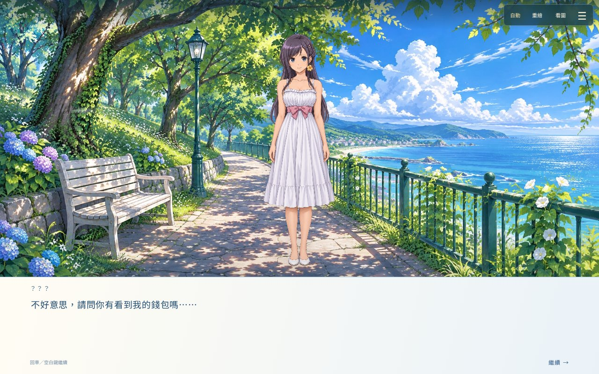
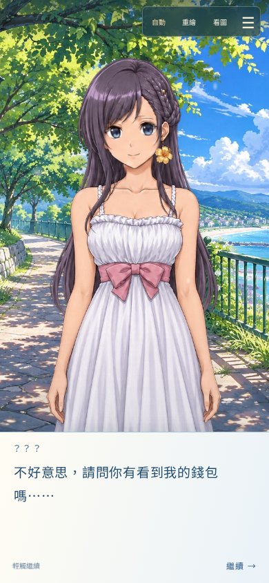

# 戀愛物語：湛藍回憶

**有些相遇，像海風一樣。**

一段夏日小鎮裡的戀愛故事，重新在瀏覽器裡展開。

### [✧ 進入湛藍回憶，開始遊戲](https://ymhomer.github.io/AzureMemories/)

單人故事 · 中文配音 · 手機與電腦 · 不需安裝或註冊

## 走進這個夏天

海風鎮的街道、樹蔭下的公園，還有旅途中不期而遇的人。
跟著以翔，從初次相遇開始，在對話與選擇之間，慢慢拼起屬於自己的回憶。

《湛藍回憶》是一款以閱讀、交談與選擇推進的戀愛故事遊戲。本專案將早期 Java 手機版帶到網頁，保留原作故事與分支，搭配重新繪製的日系美術、中文角色配音，以及適合觸控與鍵盤的遊玩介面。

## 先看一眼，故事裡的風景

<em>一場相遇，一句問候。畫面取自初章實際遊玩。</em>

也可以握在手裡，慢慢讀——手機直向畫面

## 用自己的步調，留下回憶

- **兩種美術，一段故事**：隨時切換重繪與原作圖像，各自保留閱讀設定。
- **聽她說，也讀她的心情**：不同角色的中文合成配音，搭配自動播放、閱讀預設與戲劇字幕。
- **循著路牌去旅行**：一次查看可前往的地點，也能交談、觀察，體驗故事中的情境互動。
- **把走過的路好好收藏**：回顧已讀章節與路線，欣賞已解鎖的人物、美術、道具與結局紀念圖。
- **隨時停下，下次繼續**：瀏覽器本機存檔，支援手動保存、讀取及匯出備份。

## 開始之前

直接開啟 **[遊戲入口](https://ymhomer.github.io/AzureMemories/)**，等首段畫面準備好後，選擇「進入回憶」與「開始遊戲」。首次載入需要網路；也可以略過開場，遇到新畫面時再等待載入。

| 遊玩方式 | 操作 |
| --- | --- |
| 手機、平板 | 輕觸繼續；點選回應與場景互動；長文字可上下滑動。 |
| 電腦 | 滑鼠點選，或以空白鍵／Enter 繼續；選項可用方向鍵與 Enter。 |
| 保存與設定 | 右上角選單分為「旅程、閱讀、回憶、系統」；完整說明也在「關於這段回憶」。 |

**存檔只留在目前瀏覽器，沒有雲端同步。** 更換裝置或清除網站資料前，請先匯出存檔；不要用清除網站資料的方式更新遊戲。手機與電腦皆有版面支援，實體裝置的體驗仍持續調整。

## 關於這段回憶

原作故事、原圖與音樂：**奧爾資訊（Auer）**。本專案為非官方網頁重製，原作內容權利歸原權利人所有；重繪美術由圖像生成工具輔助製作，角色語音使用 Microsoft Edge TTS，並非真人配音。部分結局紀念圖與收尾演出為本版新增詮釋。

維護：**ymhomer** · 程式與介面：**Codex 協作**

[版本紀錄](docs/RELEASE_NOTES.md) · [回報遊玩問題](https://github.com/ymhomer/AzureMemories/issues)

---

那一年，海風依然記得。

<a href="https://ymhomer.github.io/AzureMemories/">回到海風鎮，開始這段回憶 →</a>

